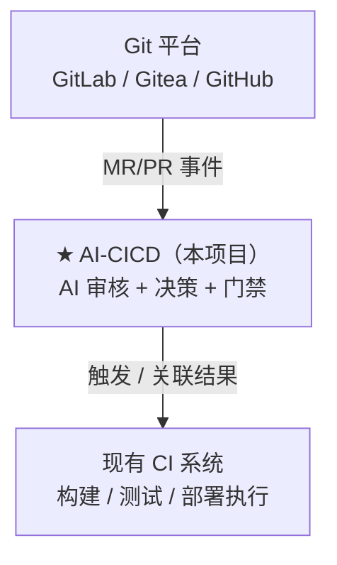

# 01 · 愿景与定位

> v0.1 · 2026-09-24

## 愿景

让每一次合并请求都经过一位**不知疲倦、了解项目上下文、立场中立**的 AI 审核者，
把「代码必须有人审」变成「代码必须有质量把关」，把人从重复性审查中解放出来，
聚焦真正的架构与业务决策。

## 定位

**AI 审核门禁 + 轻量 CI/CD 编排**，自部署（self-hosted），外挂现有 CI。

## 对标产品

| 产品 | 类型 | 与本项目的关系 |
|------|------|----------------|
| CodeRabbit | SaaS AI 代码审查 | 场景最接近，但是 SaaS、闭源、数据出域 |
| GitHub Copilot Code Review | 平台内建审查 | 绑定 GitHub，不可自部署 |
| Drone / Woodpecker CI | 自部署轻量 CI | **形态对标**：轻量、单二进制、容器化 |
| Graphite Diamond | AI 审查 | SaaS，面向 PR 堆栈管理 |
| SonarQube | 静态质量门禁 | 规则式而非 AI；门禁概念可借鉴 |

## 差异化

1. **自托管、数据不出内网**：可对接本地/私有 LLM（Ollama 等），适合对代码保密有要求的团队。
2. **外挂而非替代**：不动现有 CI 资产，接入成本低，可灰度、可随时摘除。
3. **自主权可配置且分级**：从「仅建议」到「受限执行」由策略文件控制，团队按信任度渐进放开。
4. **决策可审计、可重放**：每次审核留存输入快照与模型版本，出问题可追溯。

## 非目标（v1 明确不做）

- 不重造 CI 执行引擎（复用现有 CI 的 runner / Job 能力）。
- 不做 SaaS 多租户平台（单团队/单组织自部署优先）。
- 不做通用 IDE 插件 / 本地开发辅助（聚焦合并门禁场景）。
- 不追求替代人工架构级评审，聚焦可机械判断的质量维度。
