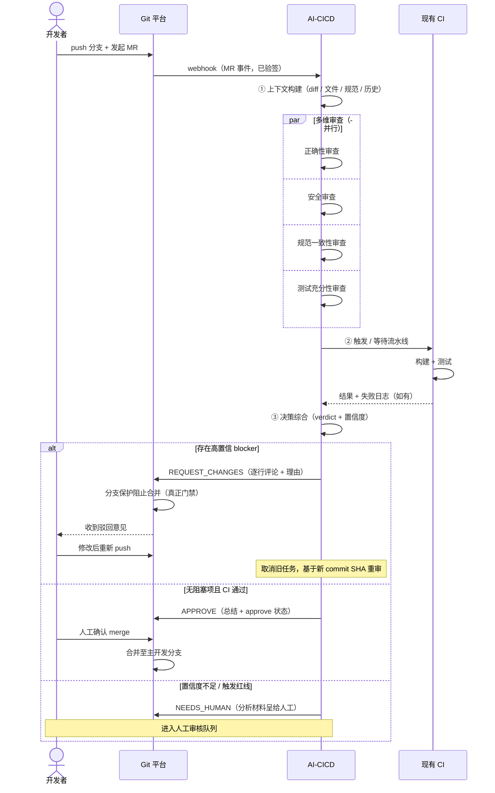

# 02 · 核心场景

> v0.2 · 2026-09-24（Gitea / 真门禁已决，见 08）

## 主场景：MR 触发 AI 审核门禁（Happy Path）

### 逐帧说明

1. **触发**：开发者向主开发分支发起 MR/PR，Git 平台推送 webhook 至 AI-CICD 接入层。
2. **上下文构建**：拉取 diff、变更文件全量、MR 描述、项目规范文件、相关历史记录。
3. **AI 审查**：多维审查并行执行（正确性 / 安全 / 规范 / 测试充分性），同时关联现有 CI 的执行结果；
   CI 失败时 AI 读取日志做根因诊断。
4. **决策**：综合各维度 findings → 结构化 verdict（含置信度）。存在 blocker 级问题 → 驳回/要求修改；
   置信度不足 → 转人工（NEEDS_HUMAN）。
5. **回写**：以 Gitea API 提交逐行评论 + 审核总结 + approve / request-changes 状态。
   严格门禁模式下（已决），AI 驳回配合分支保护使合并在**平台层面被真正阻止**；
   **merge 动作永远由人执行**（或由策略显式授权后才允许自动）。
6. **迭代**：开发者新 push 后，旧审核任务取消，基于新 commit SHA 重审（版本校验防竞态）。

## 次要场景

### S1 · CI 失败诊断

CI 挂了 → AI 读取失败日志 + 相关代码 → 在 MR 上给出「根因分析 + 修复建议」，
高置信时可直接附上建议补丁（不自动提交，除非策略允许）。

### S2 · 人工兜底

AI 置信度低 / 触发策略红线 / 审核超时 → 进入人工审核队列，
AI 的分析结果作为参考材料呈给人工审核者。

### S3 · 驳回申诉

开发者认为 AI 驳回有误 → 在 MR 评论中 `@ai-cicd re-review [理由]` →
携带申诉理由重审一次；仍维持则必须人工介入。防死循环：自动重审有次数上限。

### S4 · 规范/约定检查

项目自定义规范（`.ai-cicd.yaml` 中声明 + 仓库内 CONVENTIONS 文档）→
作为审查上下文注入，检查 MR 是否违反团队约定。

## 场景边界（明确不覆盖）

- 直接 push 到主分支（不经过 MR）的代码 —— 依赖分支保护规则，属 Git 平台职责。
- 部署编排的完整流水线设计（发布策略、灰度等）—— 留到 M3 之后。
