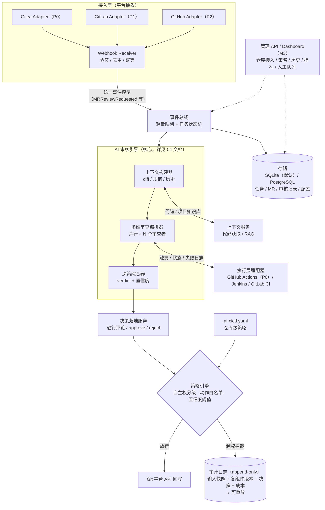
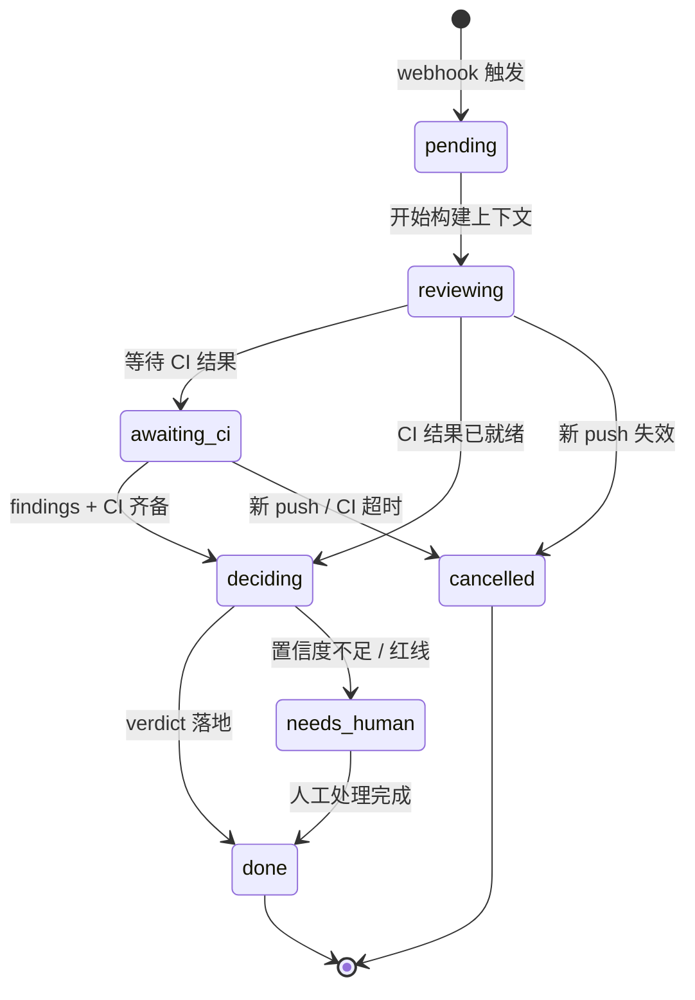

# 03 · 总体架构

> v0.2 · 2026-09-24（Gitea P0 / Go / GH Actions 已决，见 08）

## 架构总览

### 任务生命周期状态机

## 组件职责

| 组件 | 职责 | 关键约束 |
|------|------|----------|
| 接入层 | 将各 Git 平台 webhook 翻译为统一事件模型 | 平台差异不出此层；签名校验防伪造 |
| 事件总线 | 任务排队、生命周期状态机、取消与重试 | 轻量实现（进程内队列起步，可替换为 Redis） |
| AI 审核引擎 | 多维审查编排、决策综合 | 无状态：给定相同输入+模型版本，输出可重放 |
| 上下文服务 | 拉取 diff/文件/历史，构建审查上下文 | 只读；大 diff 分片策略在此实现 |
| 执行层适配器 | 触发/查询现有 CI，拉取失败日志 | 同一抽象覆盖 GitHub Actions / Gitea Actions / Jenkins / GitLab CI 等 |
| 决策落地服务 | 将 verdict 写回 Git 平台 | **唯一**对外产生副作用的出口，强制过策略引擎 |
| 策略引擎 | 判定每个动作允许/需审批/禁止 | 详见 05 文档 |
| 存储 + 审计 | 持久化任务与审核记录，审计不可篡改 | append-only 审计表 |

> 与 Gitea 的具体交互 —— 读 MR 代码的 API 路径、审核结果在 Gitea 网页上的四个呈现位与
> 门禁落地方式 —— 详见 [09-gitea-integration.md](09-gitea-integration.md)。

## 关键设计原则

1. **事件驱动、组件无状态化**：审核引擎不持有状态，任务状态在总线的状态机里，崩溃可恢复、可重放。
2. **平台抽象（Adapter 模式）**：统一 `MR/PR / Commit / Review` 领域模型，新增 Git 平台 = 新增一个 adapter。
3. **单一副作用出口**：AI 的任何对外动作（评论/approve/驳回）只经决策落地服务发出，且必须通过策略引擎校验。
   这是「受限执行者」在架构上的落点 —— **即使模型被诱导，越权动作也在落地层被拦截**。
4. **版本化一切**：prompt 模板、审查规则、策略文件、模型均带版本号，审计记录可精确重放历史决策。
5. **幂等与竞态防护**：审核结果携带 commit SHA，回写前校验 SHA 未变；新 push 触发取消旧任务。
6. **渐进增强**：从「仅评论建议」到「门禁驳回」到「受限执行」，能力由策略文件逐级放开，架构不用改。

## 部署形态（v1 目标）

单二进制 / 单容器 + SQLite，`docker-compose` 一把拉起；LLM 通过 provider 抽象对接
GLM / DeepSeek 等 OpenAI 兼容在线 API（Ollama 本地为可选）。规模增长后存储换 PostgreSQL、队列换 Redis，其余不变。
