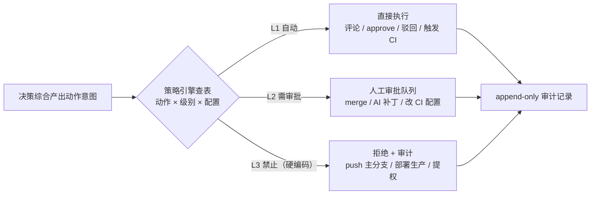

# 05 · 自主权与安全设计

> v0.2 · 2026-09-24（Gitea 真门禁已决）
> 定位：AI 是**受限执行者** —— 低风险自动执行，高风险人工审批，红线操作禁止。

## 自主权三级分类

### L1 · 自动执行（无需人工）

| 动作 | 说明 |
|------|------|
| 在 MR 上发评论 / 逐行 review | 只读代码 + 写评论 |
| 提交审核总结报告 | 信息呈现 |
| 设置 review 状态：approve / request-changes | **不等于 merge**，可被人覆盖 |
| 驳回 MR（REQUEST_CHANGES + 理由） | 开发者修改后重审即可，可申诉；严格模式下由 Gitea 分支保护**真正阻止合并**（见下文） |
| 触发现有 CI 流水线 | 等同于人点一下重跑 |
| 请求补充信息（在 MR 上提问） | 引导开发者补充上下文 |

### L2 · 需人工审批（默认禁止自动，策略可显式放开）

| 动作 | 审批原因 |
|------|----------|
| merge 合并 MR | 直接改变主分支，影响所有人 |
| 提交修复补丁到 MR 分支 | AI 写代码进入他人分支，需作者/审核人同意 |
| 修改 CI 配置文件 | 影响后续所有构建 |

### L3 · 禁止（任何配置下都不允许）

| 动作 | 原因 |
|------|------|
| 直接 push 主开发分支 / 绕过 MR | 摧毁门禁本身 |
| 部署生产环境 / 删除资源 | 破坏性，不可逆风险 |
| 修改分支保护规则 / 修改自身策略配置 | 提权行为，自锁死 |
| 修改 Git 平台账号权限 | 提权行为 |

> L3 在代码层面硬编码，不出现在任何可配置项中 —— 策略文件写错也不会放开。

## 策略引擎与配置

仓库级配置文件 `.ai-cicd.yaml`（进版本库，评审即变更策略）：

```yaml
version: 1
review:
  dimensions: [correctness, security, convention, test-sufficiency]
  max_diff_lines: 2000          # 超出转摘要模式
  ci:
    required: true              # CI 未通过不得 approve
    timeout_minutes: 30
decision:
  block_threshold: 0.8          # blocker 置信度阈值，低于转人工
  on_low_confidence: human      # human | approve_with_note
gate:
  mode: strict                  # strict=AI 驳回真正阻止合并（依赖分支保护）/ advisory=仅评论
autonomy:
  level: L1                     # L1=仅评论+门禁状态
  auto_merge: false             # L2 动作，默认关；true 时仍要求 confidence>=0.9 且无 blocker
  auto_patch: false             # AI 自动提交修复补丁，默认关
appeal:
  max_auto_re_reviews: 1        # 申诉自动重审上限，超出必须人工
```

策略引擎是决策落地服务的**前置强制关卡**（见 03 文档）：每个对外动作先查表
（动作 × 级别 × 配置），不匹配即拒绝并记录审计。策略校验失败 = 拒绝，不存在绕过路径。



## Gitea 门禁落地（已决：驳回必须真正阻止合并）

AI 驳回不是「建议」，而是**平台层面真实阻止合并**，由 Gitea 受保护分支配置实现。
接入引导时自动检查以下配置并提示缺失项：

| Gitea 受保护分支设置 | 建议值 | 作用 |
|----------------------|--------|------|
| Required approvals | ≥ 1，AI 账号计入 | AI approve 是放行条件之一 |
| Block merge on rejected reviews | 开启 | **存在 REQUEST_CHANGES 审核时禁止合并 —— 门禁核心** |
| Dismiss stale approvals | 开启 | 新 push 后旧 approval 失效，与本系统「新 push 重审」天然闭环 |
| Block merge on out-of-date branches | 开启 | 防止基于旧代码合并 |

配套要求：

- AI 使用**专用 bot 账号**，具备仓库写权限并加入审核白名单，其 approval 才计为有效
  （具体权限语义以目标 Gitea 版本为准，列为 M0 验证项）。
- 门禁模式开关 `gate.mode`（见上方配置）：`strict` = 如上真正阻断；
  `advisory` = AI 仅评论不改 review 状态，用于仓库接入灰度期。

## 人工兜底机制

触发 NEEDS_HUMAN 的情况：

1. blocker 级 finding 置信度低于阈值（拿不准的不武断）。
2. 注入启发式扫描命中（疑似试图操纵审核）。
3. 超 MR 规模上限 / 审核超时 / LLM 调用反复失败。
4. 申诉重审次数耗尽。

兜底 = 任务进入人工审核队列，AI 的分析材料（findings + 证据 + 初步意见）作为参考呈给人工。
**兜底是安全网，不是常态** —— 队列积压情况进运营指标，持续调优阈值减少误转人工。

## 审计（不可变、可重放）

每次审核任务落一条 append-only 审计记录：

```
任务ID | 仓库 | MR | commit SHA | prompt模板版本 | 规则版本 | 策略版本
  | 模型(provider/版本) | 各维度findings(脱敏快照) | verdict | 置信度
  | 耗时 | token成本 | 最终落地动作 | 落地结果
```

- **可重放**：同输入 + 同版本组合可复跑对比（模型漂移检测、事故复盘）。
- **不可变**：审计表只增不改，管理界面只读。

## 权限与密钥最小化

| 凭据 | 权限范围 |
|------|----------|
| Git 平台 token（标准模式） | read:code + write:review/comment，**无 merge/push** |
| Git 平台 token（auto_merge 开启时） | 单独一个带 merge 权限的 token，独立存储、独立审计 |
| 现有 CI 的触发凭据 | 仅触发/查询权限 |
| LLM API key | 仅审核引擎进程可见 |

- webhook 一律验签（平台签名/HMAC），防伪造事件。
- 内网部署时支持本地模型（Ollama），代码不出域。

## 熔断与降级

AI 系统出错不能把开发流程卡死：

- **LLM 不可用**：审核降级为「CI 结果门禁 + 人工审核」，MR 不被无限阻塞；
  恢复后自动补审（标注补审时间）。
- **误杀率异常**（驳回被人推翻的比例超阈值，滑动窗口统计）：自动降级为
  「仅建议模式」（只评论不驳回），并告警，人工介入调优后再恢复门禁。
- **熔断器**状态进运营指标面板。
