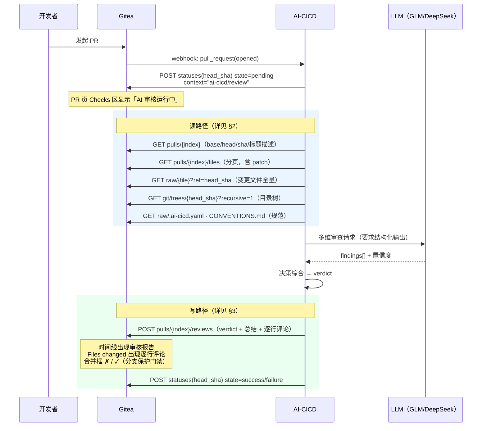
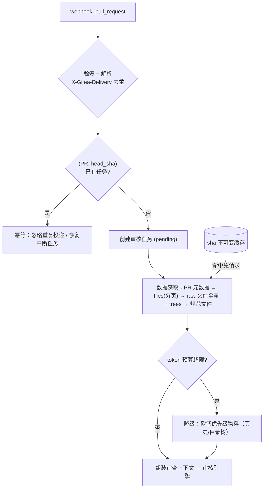

# 09 · Gitea 集成深化：读 MR 代码 与 网页呈现

> v0.1 · 2026-09-24
> 回答两个问题：**系统如何读到 MR 的代码**（§2 读路径）；**AI 审核结果在 Gitea 网页上如何呈现、门禁如何生效**（§3 写路径）。

## 0 · 全链路 I/O 时序



## 1 · Bot 账号（呈现的主体）

所有 AI 内容都以**专用 Gitea 用户账号**（如 `ai-cicd-bot`，自定义头像）发出：

- 网页上每条 AI 评论/审核都带 bot 的头像与名字，人机一目了然，天然区分于人类审核者。
- 权限：仓库**写权限** + 加入分支保护审核白名单 → 其 approval 计为有效审批
  （具体语义以目标 Gitea 版本为准，M0 验证项，见 §5）。
- token 独立于任何个人账号，便于审计与随时吊销。

## 2 · 读路径：怎么读到 MR 的代码

### 2.1 触发与鉴权

| Webhook 事件 | 触发场景 | 动作 |
|--------------|----------|------|
| `pull_request` (opened / synchronized / reopened) | 新 PR、新 push | 创建/重置审核任务（synchronized → 取消旧任务） |
| `issue_comment` (created) | 评论命令 | 解析 `@ai-cicd-bot re-review [理由]` 等指令 |

- 验签：`X-Gitea-Signature`（HMAC-SHA256，secret 按仓库 webhook 配置）+ `X-Gitea-Event` 判型。
- 幂等：按 `(PR, head_sha)` 建任务唯一键；`X-Gitea-Delivery` 去重 webhook 重复投递。

### 2.2 数据获取清单（Gitea API）

| # | 数据 | API | 用途 |
|---|------|-----|------|
| 1 | PR 元数据 | `GET /repos/{o}/{r}/pulls/{index}` | base/head 的 ref+sha、标题/描述、状态 |
| 2 | 变更文件 + diff | `GET /repos/{o}/{r}/pulls/{index}/files?limit=&offset=`（分页） | 每项含 `filename / status / additions / deletions / patch`，`patch` 即 unified diff hunk 文本 |
| 3 | 文件全量内容 | `GET /repos/{o}/{r}/raw/{filepath}?ref={head_sha}` | 理解 diff 周边上下文（函数整体、import 区） |
| 4 | 目录树 | `GET /repos/{o}/{r}/git/trees/{head_sha}?recursive=1` | 结构感知（改动落在哪一层），注意 `truncated` 标志 |
| 5 | 规范/配置 | raw 取 `.ai-cicd.yaml`、`CONVENTIONS.md`（base 分支版本） | 审查规则与团队约定 |
| 6 | 历史 PR（可选） | `GET /repos/{o}/{r}/pulls?state=closed` | 同类问题历史裁决，供一致性参考 |

> diff 语义：Gitea 的 PR diff 基于 merge-base（base...head），files 接口返回的即最终合并效果
> 需要审查的内容，无需自己再算合并基。

### 2.3 diff 组装与行号基准

- 遍历 `files` 分页结果，把各文件的 `patch` 拼装成完整 diff；按 04 文档的策略分片。
- 从 hunk 头（`@@ -a,b +c,d @@`）解析**新文件行号**，与 findings 的 `file + line` 对齐 ——
  这是后续内联评论 `new_position` 的落点。
- 约束：**Gitea 只接受落在 diff 命中行上的内联评论**；finding 指向 diff 之外的行
  （如"该函数缺少测试"指到未变更处）→ 降级写入总结报告，不强行内联。

### 2.4 获取策略：纯 API vs git 克隆

| 方案 | 优点 | 缺点 | 结论 |
|------|------|------|------|
| **纯 API** | token 只读即可、无仓库密钥管理、按 sha 天然幂等、实现简单 | 多次 HTTP 往返；超大 PR 分页多 | ★ MVP 采用 |
| git 浅克隆（`--depth 1`） | 一次拿全、可跑本地工具（lint 之类） | 需 deploy key、工作目录生命周期管理 | M2+ 大仓库可选加速，接口预留 `SourceProvider` |

### 2.5 缓存与预算

- **sha 不可变缓存**：raw 文件 / trees / files 均以 commit sha 为键缓存（内容永不变），
  重审与新 push 时增量拉取，大幅减少 API 调用。
- **token 预算器**：按 04 阶段 1 的物料优先级注入（diff > 文件全量 > 规范 > 目录树 > 历史），
  超预算从低优先级开始砍。



## 3 · 写路径：在 Gitea 网页上长什么样

### 3.1 四个呈现位（同一份审核结果）

一次审核完成，结果落在 PR 页面的四个位置：

| 呈现位 | Gitea 页面位置 | 载体 | 内容 |
|--------|---------------|------|------|
| ① 审核总结报告 | Conversation 时间线 | review 的 `body` | verdict + 各维度结论表 + 阻塞原因 + 元信息 |
| ② 逐行评论 | Files changed 页，钉在具体 diff 行 | review 的 `comments[]` | 单条 finding：严重度 + 问题 + 证据 + 建议 |
| ③ 审核状态与门禁 | 合并框（merge box） | review 的 `event` 类型 | ✓ APPROVED 计入审批数 / ✗ Request Changes 阻止合并 |
| ④ 提交状态 | PR 头部与 commit 的 Checks 区 | commit status（`ai-cicd/review` context） | ⏳ pending → ✅ success / ❌ failure，可点击跳详情 |

PR 页面标注示意：

```
Gitea · PR #42  feat: 重构登录逻辑
┌───────────────────────────────────────────────────────────────┐
│ ⏳ ai-cicd/review — AI 审核中…                        ← ④ Checks │
│                                                                │
│ ┌─ 合并框 ─────────────────────────────────────────┐            │
│ │ ✗ 需要修改 — ai-cicd-bot 请求了修改               │ ← ③ 门禁    │
│ │ 审批 0/1 · 存在被拒绝的审核                        │            │
│ └──────────────────────────────────────────────────┘            │
├─ Conversation ─┬─ Files changed ─┬─ Commits ────────────────────┤
│ Conversation:                                                   │
│ ┌─ 🤖 ai-cicd-bot · AI 审核报告 · ❌ 要求修改 ──────┐             │
│ │ ## 🤖 AI 审核报告 · ❌ 要求修改                    │ ← ① 总结    │
│ │ | 维度 | 结论 | B/M/m |  …                        │            │
│ └───────────────────────────────────────────────────┘            │
│ Files changed:                                                  │
│  src/auth/login.py                                              │
│  @@ -40,7 +40,8 @@                                              │
│  +  query = f"SELECT * FROM users WHERE id={uid}"               │
│  ┌─ 🤖 ai-cicd-bot · 🔴 blocker · 疑似 SQL 注入    ─┐            │
│  │  f-string 直接拼接用户输入 → 改参数化查询         │ ← ② 逐行    │
│  └─────────────────────────────────────────────────┘            │
└─────────────────────────────────────────────────────────────────┘
```

### 3.2 审核提交：一次 API 调用完成 ①②③

Gitea 的 Create Review 接口支持**单次调用同时提交 verdict + 总结 + 多条逐行评论**：

```
POST /repos/{o}/{r}/pulls/{index}/reviews
{
  "event": "REQUEST_CHANGES",          // ← ③ 合并框效果
  "body": "<① 总结报告 markdown>",      // ← ① 时间线
  "comments": [                        // ← ② Files changed 逐行
    { "path": "src/auth/login.py",
      "new_position": 43,
      "body": "🔴 **blocker · 疑似 SQL 注入**：f-string 直接拼接用户输入…\n建议：参数化查询" }
  ]
}
```

verdict → Gitea review event 映射（确定性代码，见 04 决策综合）：

| verdict | review event | 合并框效果（分支保护开启时） |
|---------|--------------|------------------------------|
| APPROVE | `APPROVED` | ✓ 计入审批数，满足 required approvals |
| REQUEST_CHANGES / REJECT | `REQUEST_CHANGES` | ✗ **Block merge on rejected reviews 生效，真正阻止** |
| NEEDS_HUMAN | `COMMENT` | 不计入审批也不阻止，报告显式标注「转人工」 |
| advisory 模式（任意 verdict） | `COMMENT` | 仅呈现意见，不做门禁（灰度接入用） |

> 审核流也可三步走（建 pending review → 追加评论 → 提交），供流式输出场景；
> MVP 用上述单次调用，失败重试幂等（见 3.6）。

### 3.3 总结报告模板（① 的内容，Gitea markdown）

```markdown
## 🤖 AI 审核报告 · ❌ 要求修改

| 维度 | 结论 | 🔴B | 🟠M | 🟡m |
|------|------|----|----|----|
| 正确性 | ⚠️ 有问题 | 1 | 2 | 0 |
| 安全   | ❌ 有风险 | 1 | 0 | 1 |
| 规范一致性 | ✅ 通过 | 0 | 0 | 2 |
| 测试充分性 | ⚠️ 不足 | 0 | 1 | 0 |

**阻止合并的原因：**

| # | 严重度 | 位置 | 问题 |
|---|--------|------|------|
| 1 | 🔴 blocker | `src/auth/login.py:43` | 疑似 SQL 注入（f-string 拼接用户输入） |

> 逐行评论已标注在 **Files changed** 页。
> ⏱ 96s · 🤖 glm-4.7 · 💰 ~12k tokens
> 认为驳回有误？回复 `@ai-cicd-bot re-review <理由>`（自动重审上限 1 次）
> *AI 生成内容，最终裁决以人工复核为准。*
```

（具体渲染以实例的 markdown/HTML 白名单配置为准，M0 在目标实例上验证。）

### 3.4 提交状态（④）：门禁的第二重形态

```
POST /repos/{o}/{r}/statuses/{head_sha}
{ "state": "success|failure|pending", "context": "ai-cicd/review",
  "description": "AI 审核通过 / 存在 2 个 blocker / 转人工",
  "target_url": "https://ai-cicd.internal/tasks/{id}" }
```

- 生命周期：任务创建即报 `pending`（PR 页立刻可见「AI 审核中」），完成时置终态：
  APPROVE → `success`；REQUEST_CHANGES / NEEDS_HUMAN → `failure`（description 区分）。
- 分支保护可将 `ai-cicd/review` 设为 **required status check** —— 与 ③ 的 review 门禁
  语义等价的另一种落法，接入方二选一或并用（status 法的好处：merge box 顶部更醒目，
  且 target_url 可直达本系统任务详情页）。
- 新 push → 新 head_sha → 旧 status 不再相关，重新走 pending → 终态。

### 3.5 时间线上的完整体验

1. PR 创建 → Checks 区出现 ⏳ `ai-cicd/review` 运行中。
2. 数分钟内 → 时间线出现 🤖 审核报告（①），Files changed 出现逐行评论（②）。
3. 合并框：✗ 显示「ai-cicd-bot 请求修改」/ ✓ 审批 1/1（③）。
4. 开发者修改并 push → 旧 approval 被 dismiss（Dismiss stale approvals）→
   系统检测 `synchronized` 自动重审 → 回到 1。
5. 开发者申诉 → 评论 `@ai-cicd-bot re-review 理由` → `issue_comment` webhook 触发带理由重审。
6. 转人工时 → 报告标注 NEEDS_HUMAN，人工在 Gitea 上正常 review，人的 approve 可使门禁通过。

### 3.6 写入幂等与防重复

- review 提交前查该 PR 上 bot 的既有 review（`GET .../reviews`），同一 `head_sha` 只留一份
  有效审核（重复任务被 §2.1 的唯一键挡住，此处是双保险）。
- bot **不响应自己的评论**（创建者 id == bot id 直接丢弃），杜绝自触发循环。
- 所有写操作失败重试，以「同 (PR, head_sha) 至多一条有效 review + 一条终态 status」为收敛目标。

## 4 · 权限与安全要点

- bot token 最小权限：读（pulls/files/raw/trees）+ 写（reviews/comments/statuses/webhook 订阅）；
  **无 merge、无 push、无管理员**（对应 05 文档 L3 禁区）。
- webhook secret 按仓库配置，入库加密存储。
- 注入防护联动：即使 LLM 被诱导产出越权「动作」，落地层只有上述三个写 API 白名单（09 与 03 原则 3 一致）。

## 5 · M0 需在目标 Gitea 实例上验证的清单

- [ ] `files` 接口单页上限、超长 patch 是否截断，及分页遍历的正确姿势
- [ ] `new_position` 行号语义（新文件行号）与 hunk 外评论是否被拒绝（决定降级策略）
- [ ] bot（写权限/白名单）的 approval 是否计为 official，REQUEST_CHANGES 是否真实阻止合并
- [ ] 目标 Gitea 版本：分支保护选项名、Checks 区 UI、status 展示形态
- [ ] `issue_comment` webhook 对 review 评论是否也触发（防止误解析报告自身）
- [ ] markdown 渲染（表格 / details / emoji）在实例白名单配置下的实际效果
